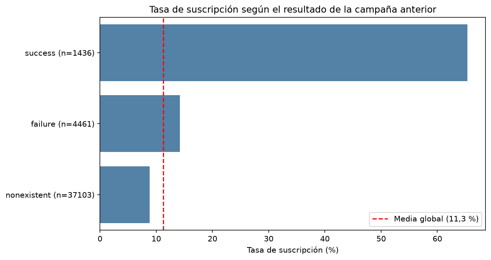
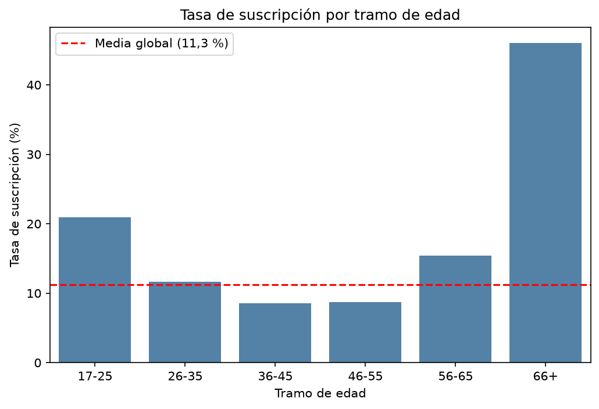
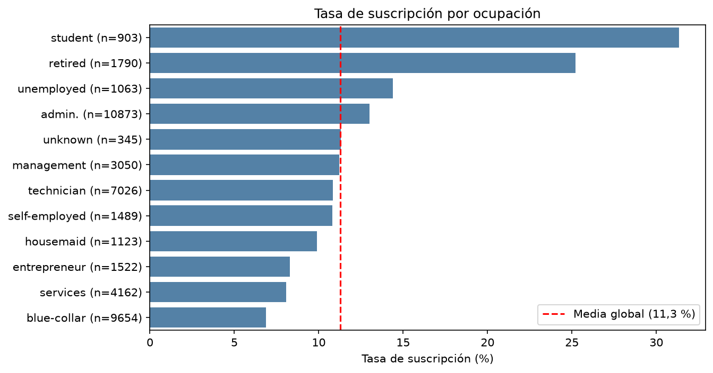
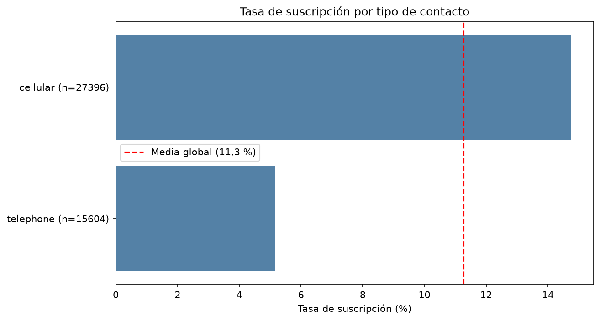
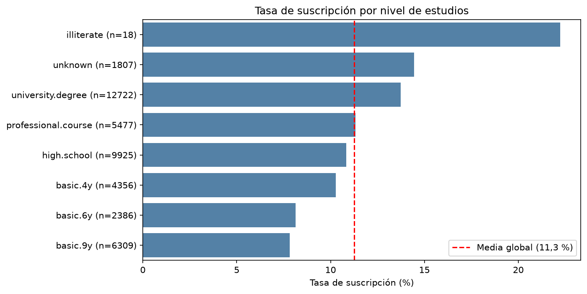
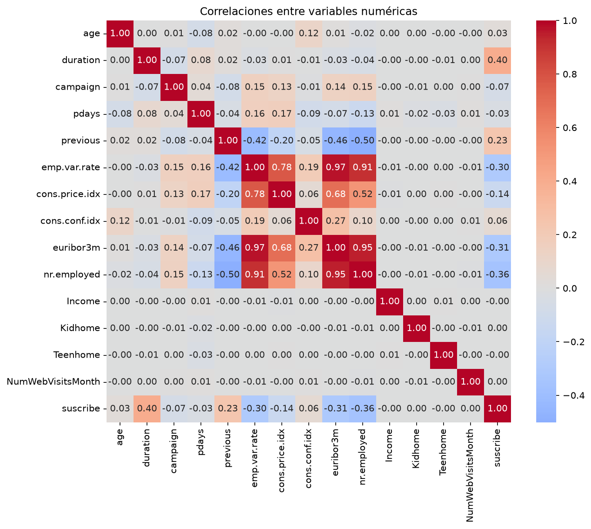
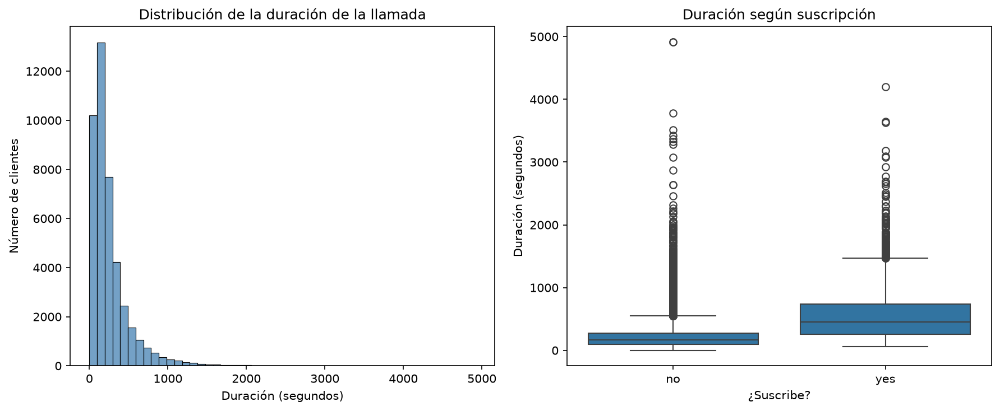
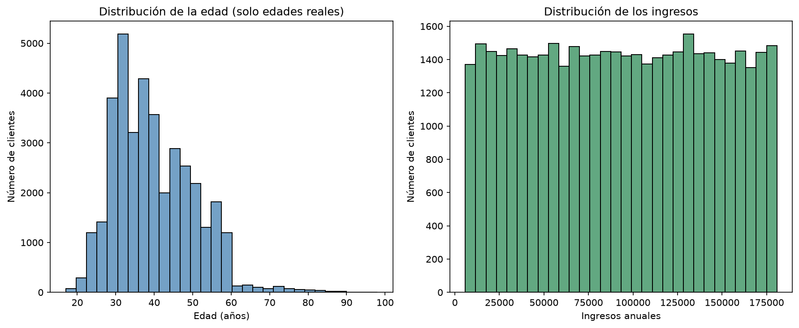

# Análisis exploratorio: campañas de marketing de un banco portugués

## 1. Objetivo

Este proyecto es un análisis exploratorio de datos (EDA) con Python sobre campañas de marketing telefónico de un banco portugués. El producto ofrecido es un depósito a plazo.

La pregunta que guía el análisis es: **¿qué tipo de clientes aceptan contratar el depósito tras una llamada, y qué factores influyen?** La variable que se intenta explicar es `y` (suscribe: sí o no).

Herramientas: Python, pandas, matplotlib, seaborn y Visual Studio Code.

## 2. Datos

| Archivo | Contenido |
|---|---|
| `raw/bank-additional.csv` | 43.000 llamadas: datos del cliente, de la campaña y del contexto económico |
| `raw/customer-details.xlsx` | 43.170 clientes repartidos en 3 hojas (una por año de alta): ingresos, hijos y visitas web |

Los dos archivos se unen por el identificador del cliente (`id_` en el CSV, `ID` en el Excel). Las 43.000 llamadas tienen su cliente en el Excel. Los 170 clientes restantes no tienen llamada en este dataset.

## 3. Estructura del repositorio

```
├── raw/            Datos originales sin modificar
├── procesado/      Datos limpios y unidos (bank_clean.csv)
├── notebooks/      01_exploracion.ipynb: limpieza, análisis y gráficos
├── graficos/       Imágenes generadas por el notebook
└── README.md
```

## 4. Limpieza y transformación

El resultado final es `procesado/bank_clean.csv`, con 43.000 filas y 32 columnas. Estas son las decisiones tomadas:

| Problema detectado | Decisión |
|---|---|
| Columna `Unnamed: 0` (índice sobrante) en ambos archivos | Eliminada |
| `cons.price.idx`, `cons.conf.idx`, `euribor3m` y `nr.employed` venían como texto con coma decimal | Coma sustituida por punto y conversión a número |
| `marital` y `poutcome` en mayúsculas | Pasadas a minúsculas, igual que el resto de categóricas |
| Nulos en `job`, `education` y `marital` | Marcados como `unknown`, para no inventar información |
| `default`, `housing` y `loan` codificadas como 0/1, con nulos | Traducidas a `no`/`yes` y nulos marcados como `unknown` |
| 5.120 nulos en `age` (12 %) | Rellenados con la mediana (38 años). Antes de rellenar se guarda la columna `edad_imputada`, que indica cuáles eran nulas, para analizar después la edad solo con datos reales |
| `date` en texto en español (`2-agosto-2019`) | Traducido el mes a número y convertida a fecha. Se crearon `contact_month` y `contact_year` |
| 471 nulos en `cons.price.idx` | Recuperados con el valor de otras filas con la misma situación económica. Se comprobó antes que esas columnas determinan el valor sin ambigüedad |
| 9.256 nulos en `euribor3m` (21,5 %) | **No se imputan**: ninguna combinación de otras variables determina su valor, y rellenarlos metería datos falsos |
| 248 nulos en `date` (0,6 %) | Se conservan. Esas filas solo se excluyen de los análisis por año y mes |
| `pdays = 999` (41.412 filas) | Es una marca de «nunca contactado antes», no una cantidad de días. Se sustituye por nulo y se crea la columna `contactado_antes` |
| Valores extremos en `duration` y `campaign` | Se conservan: son valores posibles, no errores |
| Duplicados | No hay claves duplicadas ni filas repetidas |

## 5. Hallazgos

Solo el **11,3 %** de los clientes (4.844 de 43.000) suscribió el depósito. Es el punto de referencia para comparar. Todos los gráficos marcan esa media con una línea roja.

### 5.1 Qué clientes suscriben más

**El resultado de la campaña anterior es el factor más fuerte.** Quien ya había aceptado antes suscribe el 65,3 % de las veces. Con un fracaso previo baja al 14,2 %, y con ninguna campaña previa, al 8,8 %.



**La edad tiene forma de «U».** Suscriben mucho más los jóvenes (17-25 años: 20,9 %) y los mayores (56-65: 15,4 %; más de 66: 46,0 %). Los de 36 a 55 años rondan el 8,6 %. La mediana de edad es casi igual en quienes suscriben y en quienes no (37 frente a 38), y por eso conviene mirar la edad por tramos.



**La ocupación coincide con la edad.** Estudiantes (31,3 %) y jubilados (25,2 %) son los perfiles más receptivos. Los trabajadores manuales (`blue-collar`, 6,9 %) son los menos.



**El tipo de contacto importa.** Al móvil se suscribe el 14,7 %, frente al 5,2 % del teléfono fijo: casi tres veces más.



**A más estudios, más suscripción.** Los universitarios llegan al 13,7 %, frente al 7,8-8,1 % de quienes tienen estudios básicos de 6 y 9 años. Los solteros (13,9 %) suscriben más que casados y divorciados (10,2 %). Las categorías con muy pocos casos (por ejemplo `illiterate`, con 18 clientes) llevan su tamaño `n` en la etiqueta del gráfico, y no deben interpretarse.



### 5.2 Qué no influye

- **Tener hipoteca o préstamo:** las tasas (10,9-11,6 %) son casi iguales a la media.
- **El año y el mes de la llamada:** la tasa se mantiene entre el 10,9 % y el 11,7 % por año y entre el 10,3 % y el 12,4 % por mes. No hay tendencia ni estacionalidad clara.
- **Los datos del Excel** (ingresos, hijos, visitas web): correlación prácticamente nula con la suscripción y con todo lo demás.
- **El número de contactos de la campaña (`campaign`)**: la mediana es 2 en quienes suscriben y en quienes no.

### 5.3 Correlaciones



- **La situación económica** (`euribor3m`, `nr.employed`, `emp.var.rate`) tiene correlación moderada y negativa con suscribir (de -0,30 a -0,36): con indicadores altos se suscribe menos. Estas tres variables están correlacionadas entre sí entre 0,91 y 0,97, así que son en la práctica una sola señal.
- **`duration`** es la variable más ligada a suscribir (0,40). La mediana es de 449 s en quienes suscriben y de 163 s en quienes no. La distribución tiene cola larga con valores extremos, y por eso se usa la mediana.
- **`previous`** (contactos en campañas anteriores) tiene correlación 0,23.
- **La edad** sale casi sin correlación (0,03) aunque influye mucho. La correlación solo mide relaciones en línea recta, y la «U» queda compensada.



## 6. Limitaciones

- **`duration` se conoce al terminar la llamada.** Describe lo ocurrido, pero no sirve para decidir a quién llamar.
- **Los datos del Excel parecen generados al azar.** Los ingresos tienen distribución uniforme, y ingresos, hijos y visitas web no se relacionan con ninguna otra variable, ni entre sí. No aportan capacidad explicativa.



- **Correlación no implica causalidad.** Por ejemplo, el móvil puede rendir más porque lo usan perfiles distintos, no por el canal en sí.
- **Los nulos conservados** en `euribor3m` y `date` reducen las filas disponibles en los análisis que los usan.
- **Las clases están desbalanceadas** (11 % de «sí»), por lo que se comparan siempre porcentajes y no conteos.
- **Pequeña incoherencia del dato original:** 4.309 de las 4.461 filas con `poutcome = failure` tienen `pdays = 999`. No se puede corregir.

## 7. Conclusiones

1. La campaña tiene una tasa de éxito baja (11,3 %), con grandes diferencias entre perfiles.
2. Los perfiles más rentables son los clientes que ya aceptaron antes, los jubilados y mayores de 66 años, los estudiantes y jóvenes, y los contactados al móvil.
3. Los trabajadores manuales y los clientes de 36 a 55 años suscriben menos que la media.
4. La situación económica influye: se suscribe menos cuando sus indicadores están altos.
5. Ingresos, hijos, visitas web, hipoteca, préstamo y fecha de la llamada no explican la suscripción.

## 8. Cómo ejecutarlo

1. Clona el repositorio y crea un entorno virtual.
2. Instala las dependencias:
   ```
   pip install pandas numpy matplotlib seaborn openpyxl jupyter
   ```
3. Abre `notebooks/01_exploracion.ipynb` en VS Code y ejecútalo entero (Run All). Las rutas son relativas a la carpeta `notebooks/`.
4. El notebook regenera `procesado/bank_clean.csv` y las imágenes de `graficos/`.

